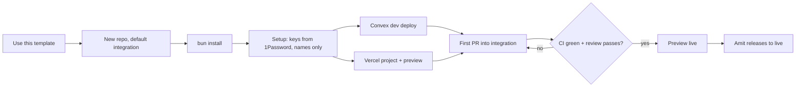
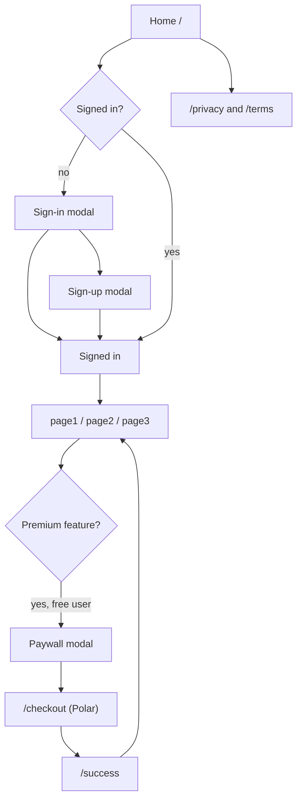

# monorepo-template — 03 App flow

> **TL;DR**
> - Two flows matter. (A) A builder makes a new app from the template. (B) An end user uses that app.
> - Flow A target: template → new repo → keys set → live preview in ONE day.
> - Flow B today: landing page → sign in / sign up (modals) → signed-in pages → paywall → checkout.
> - Mobile mirrors web: auth screens, signed-in tabs, settings, paywall.

Version: 3 Oct 2026. Marks: see `01-PRD.md`.

## 1. Flow A — make a new app (builder)

Today (REPO `README.md`, pnpm):

1. GitHub → **Use this template** → new private repo.
2. Create `integration` from the default branch.
3. `pnpm install`, then `pnpm run setup`.
4. `pnpm dev:backend` (Convex), `pnpm dev:web`, `pnpm dev:mobile`.
5. `pnpm run vercel:web` to link Vercel.

Target (Bun, AMIT 3 Oct) (commands) (EXTRAPOLATED):

1. GitHub → **Use this template** → new repo in org Levidavidspublic.
2. Default branch `integration`. Rulesets and required checks copied.
3. `bun install`.
4. Setup script reads keys from 1Password and sets them in Convex, Vercel and GitHub. Nothing printed, nothing written to a file. (A-Oct goal D3; script is in an open PR)
5. Convex deploy (dev). Vercel project linked. Magic link works on first deploy.
6. First PR into `integration` → CI → review → merge → Vercel preview.
7. Adjust 1–2 things (name, domain, legal contact). Live preview the same day. (A-Oct goal D5)

Bolt use: an app made in Bolt should drop into `apps/*` with zero backend edits. (REPO `ROADMAP.md` P-2) The exact Bolt steps: UNKNOWN.

## 2. Flow B — web app (end user)

Routes in `apps/web/app` (REPO 3 Oct):

| Route | What | Needs sign-in? |
|---|---|---|
| `/` | Home | No |
| `/page1`, `/page2`, `/page3` | Placeholder pages | Yes (from `middleware.ts`) (EXTRAPOLATED) |
| `/contact` | Contact form | Yes (EXTRAPOLATED) |
| `/privacy` | Privacy policy (Hebrew) | Yes (EXTRAPOLATED) — see note |
| `/terms` | Terms (Hebrew) | Yes (EXTRAPOLATED) — see note |
| `/checkout` | Polar checkout route | Yes (EXTRAPOLATED) |
| `/success` | After payment | Yes (EXTRAPOLATED) |

Sign-in and sign-up are modals (`SignInModal`, `SignUpModal`) opened from the `Navbar`. A paywall modal and a `PremiumGate` wrap paid features.

Note: `middleware.ts` treats only `/`, `/sign-in` and `/sign-up` as public. So legal pages would redirect a signed-out visitor to `/sign-in`. No `/sign-in` page file exists in `apps/web/app`. Both look like gaps for a ticket (reading of the code) (EXTRAPOLATED).

## 3. Flow B — mobile app (end user)

Screens in `apps/mobile/app` (REPO 3 Oct):

| Group | Screens |
|---|---|
| `(auth)` | index, sign-in, sign-up, paywall |
| `(authenticated)` | index, page1, page2, settings |
| other | `+not-found` |

1. Open app → `(auth)` index.
2. Sign in or sign up (password today).
3. Signed in → `(authenticated)` tabs.
4. Settings: profile, legal links (`EXPO_PUBLIC_PRIVACY_POLICY_URL`, `EXPO_PUBLIC_TERMS_OF_SERVICE_URL`), delete account (from `users.deleteMyAccount`) (EXTRAPOLATED).
5. Paywall → RevenueCat purchase.

## 4. Sign-in flow (target, A-Oct)

1. User types an email.
2. Convex Auth sends a magic link through Resend.
3. User taps the link → signed in.
4. Sign-up cap: Tempo and OmniAgent use 30. Whether the template ships the cap: UNKNOWN.
5. Next week: unlimited sign-ups, each approved by Amit by email (Tempo, OmniAgent). Template: UNKNOWN.

## 5. States (placeholder copy) (EXTRAPOLATED)

| Where | Empty | Loading | Error |
|---|---|---|---|
| Sign-in | — | Button spinner | "That did not work. Try again." |
| Magic link | — | "Check your email" | Link expired: send again |
| Signed-in page | Short hint + one action | Skeleton | Message in words, retry |
| Paywall | — | Spinner on buy | Payment failed: say so, no charge |
| Settings | — | Skeleton | Save failed: say so |

## Open questions

1. Should legal pages be public? (Almost surely yes — confirm.)
2. Should the template ship the sign-up cap and the approval flow?
3. Exact Bolt flow?
4. Keep `page1–3` placeholders, or replace with one example feature?

## Sources

- Repo `integration` 3 Oct: `README.md`, `ROADMAP.md`, `apps/web/app/**`, `apps/web/middleware.ts`, `apps/web/components/**`, `apps/mobile/app/**`, `apps/mobile/.env.example`, `packages/backend/convex/users.ts`.
- Basic Memory: "Weekend goals 2026-10-02" (section D), "Weekend factory plan 2026-10-02".
