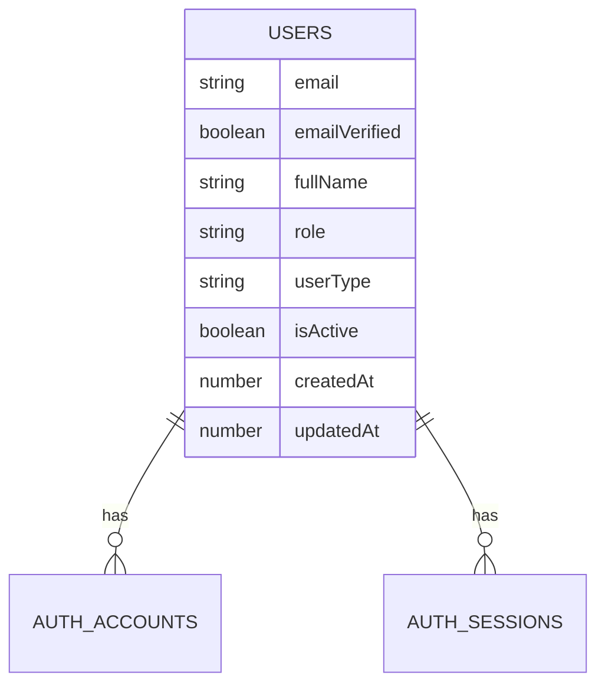
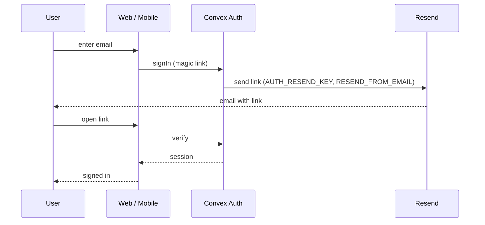

# monorepo-template — 05 Backend schema

> **TL;DR**
> - One Convex deployment. Code lives only in `packages/backend/convex/`.
> - Tables: Convex Auth tables + one `users` table. That is all today.
> - Sign-in today: email + password, 30-day session. Target: magic link via Resend.
> - Payments are NOT in the Convex schema. Polar (web) and RevenueCat (mobile) own them.
> - Some user functions check "signed in" but not "is it you". Needs a ticket.

Version: 3 Oct 2026. Marks: see `01-PRD.md`.

## 1. Fixed and open

| Item | Status | Source |
|---|---|---|
| One Convex deployment for web + mobile | Fixed | REPO `AGENTS.md` |
| Backend code only in `packages/backend/convex/` | Fixed | REPO `HARD_RULES.md` §2 |
| No Polar Convex stubs | Fixed | REPO `BILLING.md` |
| Mobile-only modules (`conversations`, `memories`, `messages`) stay out of the shared schema | Fixed until a ticket adopts them | REPO `docs/MOBILE-ONLY-CONVEX.md` |
| Magic-link sign-in | Planned (ticket M-AUTH) | REPO `PROVIDERS.md`; A-Oct goal D2 |
| Sign-up cap (30) in the template | UNKNOWN | A-Oct (cap decided for Tempo + OmniAgent) |
| Approval flow for sign-ups | UNKNOWN for the template | A-Oct (next week, Tempo + OmniAgent) |

## 2. Tables (REPO 3 Oct, `schema.ts`)

| Table | Fields | Indexes |
|---|---|---|
| Convex Auth tables (`authTables`) | Library-managed: accounts, sessions, verification codes, etc. | library |
| `users` | `email` (string), `emailVerified` (bool, optional), `fullName` (string, optional), `role` (`admin` \| `user`), `userType` (`free` \| `paid`, optional), `isActive` (bool), `createdAt`, `updatedAt` (numbers) | `by_email`, `by_role`, `by_userType` |

Auth table names in the diagram are the library's (labels) (EXTRAPOLATED).

## 3. Functions (REPO 3 Oct, `users.ts`)

| Function | Kind | Auth check | Note |
|---|---|---|---|
| `getCurrentUser` | query | Signed in | Finds user by id from token, then by email |
| `getById` | query | **None** | Anyone can read a user by id (risk) (EXTRAPOLATED) |
| `listActive` | query | **None** | Lists all active users (risk) (EXTRAPOLATED) |
| `createOrUpdateUser` | mutation | Signed in | Upsert by email |
| `updateProfile` | mutation | Signed in, **not owner** | Takes any `userId` (risk) (EXTRAPOLATED) |
| `remove` | mutation | Signed in, **not owner** | Deletes any `userId` (risk) (EXTRAPOLATED) |
| `updateUserType` | mutation | Signed in, own record | Sets `free`/`paid`. Comment says "after payment or mock". A client can call it directly (risk) (EXTRAPOLATED). |
| `deleteMyAccount` | mutation | Signed in | Looks up `_id` equal to the full token subject; may never match (EXTRAPOLATED) |

`http.ts` adds Convex Auth HTTP routes. `auth.config.ts` holds the auth provider config.

RULE (EXTRAPOLATED): before a template app goes live, these risks get one code ticket each (owner checks, no client-set `paid`).

## 4. Sign-in

Today (REPO 3 Oct, `auth.ts`):

1. Provider: Password (email + password).
2. Session length: 30 days.
3. On sign-up, a `users` row is created with `role = user`, `isActive = true`.
4. Web `middleware.ts` sends signed-out visitors to `/sign-in` for non-public routes.

Target (A-Oct):

Cap and approval checks would sit in the `createOrUpdateUser` callback (placement) (EXTRAPOLATED).

## 5. Who sees what (target) (EXTRAPOLATED)

| Actor | Sees | Never sees |
|---|---|---|
| Signed-out visitor | Home, legal pages | Any user row |
| Signed-in user | Own `users` row | Other users' rows |
| Admin (`role = admin`) | All `users` rows | Secret values |
| Payment webhooks | Set `userType` server-side | — |

Today the code does not enforce rows 2–4. See §3.

## 6. Payments data

| Surface | Source of truth | Where |
|---|---|---|
| Web | Polar | `apps/web/config/polarConfig.ts`, `apps/web/app/checkout/route.ts` |
| Mobile | RevenueCat | `apps/mobile` + Convex HTTP webhook in product repos |

`users.userType` mirrors paid state. How it is set from a webhook in the template: UNKNOWN (no webhook in `http.ts`).

## 7. Secrets and env (names only)

`CONVEX_DEPLOYMENT`, `NEXT_PUBLIC_CONVEX_URL`, `EXPO_PUBLIC_CONVEX_URL`, `CONVEX_DEPLOY_KEY`, `AUTH_RESEND_KEY`, `RESEND_FROM_EMAIL`, `POLAR_ACCESS_TOKEN`, `POLAR_WEBHOOK_SECRET`, `REVENUECAT_SECRET_KEY`, `REVENUECAT_WEBHOOK_SECRET`.
Never run `convex env list`. Never print a value.

## Open questions

1. Ship the sign-up cap and approval flow in the template?
2. Fix the owner checks in `users.ts` now (one ticket), or leave for each product?
3. Add a payment webhook route to `http.ts` in the template?
4. Keep `role` + `userType`, or move paid state out of `users`?

## Sources

- Repo `integration` 3 Oct: `packages/backend/convex/schema.ts`, `auth.ts`, `users.ts`, `http.ts`, `apps/web/middleware.ts`, `BILLING.md`, `PROVIDERS.md`, `docs/MOBILE-ONLY-CONVEX.md`.
- Basic Memory: "Weekend factory plan 2026-10-02", "Weekend goals 2026-10-02".
