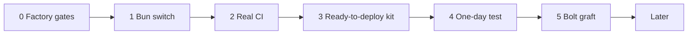

# monorepo-template — 06 Roadmap

> **TL;DR**
> - Phase 0: factory gates (org move, docs + wikis, tickets with Graphify). Automations stay OFF until done.
> - Phase 1: switch to Bun (config lane).
> - Phase 2: real CI + secret scan.
> - Phase 3: magic link + legal pages + every key slot → "deploys with 1–2 adjustments".
> - Phase 4: one-day test — a new app reaches a live preview in one day.
> - Phase 5: Bolt graft with zero backend edits.

Version: 3 Oct 2026. A roadmap of PHASES. Ticket order is a separate job. Marks: see `01-PRD.md`.
Old roadmap: `ROADMAP.md` at the repo root (P-1, P-2). This file folds it in. P-1 → Phases 2 + 3. P-2 → Phase 5.

## Phase order

Phases 1 and 2 could run together if one config-lane PR does both (EXTRAPOLATED).

## Phase 0 — Factory gates (now, A-Oct)

**Goal.** The factory can work on the template safely.
**Exit check.**
1. Repo moved to org Levidavidspublic. CI runs. Vercel preview from `integration`. Rulesets + required checks intact.
2. `docs/01`–`06` and the GitHub wiki hold this set.
3. Open tickets rewritten to the 11-field standard (3 files + 1 test, runnable DONE, deps listed) with Graphify context.
**Note.** The open setup-secrets PR is Amit's to review. Do not touch it.

## Phase 1 — Bun switch (config lane)

**Goal.** Bun is the only package manager. (AMIT 3 Oct)
**Exit check.**
1. `bun.lock` is the only lockfile. `pnpm-lock.yaml` and `pnpm-workspace.yaml` gone.
2. `bun install --frozen-lockfile` passes in CI.
3. `AGENTS.md`, `HARD_RULES.md`, `README.md` and the GitHub repo description say Bun.
4. `bun run dev:web` and the Expo dev server start (command names) (EXTRAPOLATED).
**Blockers.** `package.json` scripts and `.github/**` are guarded. Needs Amit's `config-lane` label. Expo + Convex CLI behaviour under Bun: verify first (UNKNOWN).
**First tickets.** Lockfile + workspaces · CI install steps · docs and description.

## Phase 2 — Real CI

**Goal.** The six locked job names run real commands. A secret scan exists. (A-Oct goal E2)
**Exit check.** Typecheck, Lint, Test, Scans, Third-party notices and E2E (Playwright smoke) all run real work and fail on errors. A gitleaks secret scan job runs. A build job runs. A failing PR is blocked; a passing PR merges (proof test).
**Rules.** Job names never change. Never weaken a check. (A-Oct)
**First tickets.** Typecheck + lint + build · Playwright smoke · secret scan.

## Phase 3 — Ready-to-deploy kit

**Goal.** A new app deploys with 1–2 adjustments. (AMIT 3 Oct)
**Exit check.**
1. Magic link works on first deploy (Resend + Convex Auth). (A-Oct goal D2)
2. Every key slot is listed in `.env.example` files and `docs/ENV.md`, names only. (A-Oct goal D1)
3. Setup script pulls keys from 1Password; nothing printed or written. (A-Oct goal D3)
4. Privacy, Terms, Cookies pages: English + Hebrew, public (no sign-in), marked "draft for a lawyer". (from the Tempo/OmniAgent decision) (EXTRAPOLATED)
5. Owner checks fixed in `users.ts` (see `05-BACKEND-SCHEMA.md` §3).
6. Factory pieces: CI, review config, `claude.yml`, Cursor environment, issue template, labels, `AGENTS.md`. (A-Oct goal D4)
7. How-to wiki pages: "Start a new app", "Set keys", "Deploy preview", "Release live" (titles) (EXTRAPOLATED).

## Phase 4 — One-day test

**Goal.** Prove the promise.
**Exit check.** From "Use this template" to a live preview in one working day. Time recorded. (A-Oct goal D5) Each manual step listed, then turned into a script or a doc.

## Phase 5 — Bolt graft

**Goal.** An app made in Bolt drops into `apps/*` with zero backend edits. (REPO `ROADMAP.md` P-2; AMIT 3 Oct "usable in Bolt")
**Exit check.** One Bolt export merged; `packages/backend` unchanged; CI green.
**Blockers.** Exact Bolt flow and Bun support in Bolt: UNKNOWN.

## Later (vague on purpose, REPO `ROADMAP.md`)

`packages/core`, `packages/ui`, `packages/config` slots · extension shell · Tauri desktop · image/video providers if Amit rules them in · multi-app layout examples (OmniAgent style).

## Cadence (A-Oct)

| Rule | Detail |
|---|---|
| Building | Autonomous BUILD 7 days a week once automations are on ("Shabbat light") |
| Fri–Sat | No configuration, no patching. Breakage waits for Sunday. |
| Merge | Into `integration` only: CI green + review gate (Greptile 4/5+, no open P1; Bugbot for now) + no conflicts + inside MUTATES |
| Live | Amit only. He merges `integration` → `master`. |
| Broken ticket | Fails more than 3 times → stops. Dependents pause. Others continue. |
| Lanes | Cursor: front end. Claude Code: backend, sign-in, tests. Codex: CI, docs, refactors (GPT-5.6 Terra or GPT-6 Luna). |
| Never | Any "Sol" model, Fable, Astra, Opus, Soul for code. Weakening a check. |

## Open questions

1. Bun switch and real CI: one config-lane PR or two?
2. Should Phase 3 include the sign-up cap and approval flow?
3. Who runs the one-day test, and on which app idea?
4. Bolt: which direction (import or export)?

## Sources

- Repo `integration` 3 Oct: `ROADMAP.md`, `README.md`, `.github/workflows/*`, `package.json`, `docs/TEMPLATE_STATE.md`, `docs/wiki/Tickets.md` (listed).
- `plan-v4/PLAN-FINAL.md` steps 1–7.
- Basic Memory: "Weekend factory plan 2026-10-02", "Weekend goals 2026-10-02" (section D, E), "Next week — factory decisions and research 2026-10-03", "Factory merge and deploy policy", "Factory Decisions — 2026-09-18".
