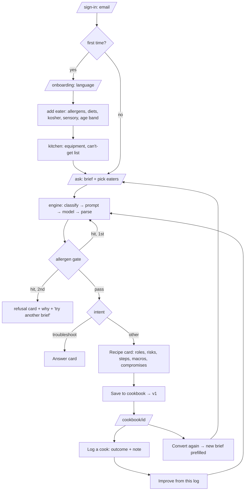

# Recipe Alchemist — App flow

**Verdict.** The app has eight routes and a bottom bar with three tabs: Ask, Cookbook and Household. Every path starts from one brief box. Every recipe goes through the allergen gate before you see it. Every saved recipe can be cooked, logged and improved into its next version. Payments and the free-tier limit appear only in the MVP phase.

## Routes
```
/sign-in                     magic link (Convex Auth)
/onboarding                  first run: language → household → first eater → kitchen
/ask                         HOME — brief box + eater picker + result
/ask/[askId]                 a past result (recipe card or answer card)
/cookbook                    saved recipes
/cookbook/[recipeId]         versions strip + cook logs + "Improve from this log"
/household                   eaters + kitchen (equipment, can't-get list, region)
/settings                    language, units, legal pages, export, delete account
/waitlist                    MVP only: shown when the email isn't on the invite list
/review                      MVP only, expert role: grade gold-set versions (grade, safe yes/no, note)
```
Bottom bar (phone), or sidebar (desktop): **Ask · Cookbook · Household**. Settings opens from the avatar. *(EXTRAPOLATED)*

## Main flow


## Screens

### Sign-in
- **Layout:** an email field and a "Send sign-in link" button. A language switch sits at the top.
- **States:**
  - Empty: the screen as above.
  - Sending: the button shows a spinner.
  - Sent: "Check your email."
  - Error: "Couldn't send. Try again."
- **AI:** none.

### Onboarding (first sign-in only)
- **Steps:** language, then household name, then the first eater, then the kitchen.
- **Eater fields:**
  - display name
  - age band: child, teen or adult
  - allergens: chips from a fixed list, plus "other" as free text, which the gate treats as a blocked term
  - diets: keto, paleo, low-calorie, high-protein, vegetarian
  - kosher level: none, parve, dairy or meat
  - sensory notes: chips (smooth only, no mixed textures, no crunch, mild flavours) plus free text
  - macro targets: only if the parent types them, and labelled "from your coach or dietitian" (RULE R2)
- **Kitchen fields:** equipment chips (oven, blender, stand mixer, freezer, Ninja Creami, air fryer…), a list of ingredients you can't get, and the region (default Israel).
- **States:** a "Skip for now" option, which creates one adult eater with no constraints. Validation messages appear inline.
- **AI:** none.

### Ask (home)
- **Layout:**
  - Brief box, with placeholder examples that rotate: soft serve, galangal, ginger beer, donuts.
  - "Paste a recipe" expander.
  - Eater picker: chips, all selected by default.
  - Fidelity toggle: Rough or 99% copycat.
  - An "Ask" button.
- **States:**
  - Loading: the steps the engine is on stream as status lines: "Reading your recipe… Checking allergens… Counting macros…"
  - Error: "The kitchen's busy. Try again." with a Retry button.
  - Free-tier limit (MVP): "3 of 3 used today" plus an upgrade link.
- **AI:** classifies the request, then writes the recipe card or answer card.

### Recipe card (in /ask and /ask/[askId])
Top to bottom:
1. Title and the intent badge.
2. The allergen banner: "Checked against: [eaters' allergens]", plus "Check every label for may-contain warnings."
3. The role table.
4. Risk flags.
5. Steps.
6. The macros line: "Source: USDA FoodData Central"; unknown ingredients are listed by name.
7. "What I had to compromise."
8. The accuracy disclaimer.
9. Actions: **Save to cookbook**, **Ask a follow-up**.

### Answer card (troubleshoot)
- Contents: the diagnosis, steps to try, "when to stop or throw it out", and risk flags.
- Action: **Save as a note on a recipe**, which opens a picker of saved recipes. *(EXTRAPOLATED)*

### Refusal card
- What it says: "I couldn't make this without [allergen] for [eater]."
- What it offers: "What would have to change", and a button to try a different brief.

### Cookbook
- **List:** cards showing the title, the latest version, the last cook outcome as a coloured word with its label, and when it was updated. Search and sort sit at the top.
- **Empty state:** "Nothing saved yet. Ask for something, then save it."
- **Recipe detail:**
  - A version strip (v1, v2…); each version is immutable.
  - The current version's card.
  - Cook logs for that version.
  - Actions: **Log a cook**, **Improve from this log** (enabled once a log exists), **Convert again**, and **Delete** with undo.

### Log a cook
- Five outcome chips: worked, rubbery, dry, spread, off-flavour.
- A note field and the date, then Save.
- **AI:** none until "Improve" is tapped. Then the engine gets the version, the log and the eaters, and returns v+1 with a line beginning "What changed because of your log: …"

### Household
- A list of eaters with Edit and Delete.
- The kitchen editor.
- Changes apply to future requests only. Saved versions keep the constraints they were checked against.

### Settings
- Language (English or Hebrew), units (metric or US).
- Legal pages in English and Hebrew.
- Export the cookbook as Markdown.
- Delete account: two steps.
- Sign out.

## Click-paths that must be true
- **CP1 Copycat with an allergen.** Sign in → Ask: "McDonald's soft serve, no ice cream machine" → eater with a dairy allergen selected → the recipe card has a role table, at least one risk flag, no dairy term, and the allergen banner.
- **CP2 Troubleshoot.** "My ginger beer isn't fizzing after 3 days" → an answer card, not a recipe card.
- **CP3 Loop.** Save as v1 → log "rubbery" with a note → Improve → v2 exists, and its card cites the log.
- **CP4 Language.** Settings → עברית → `dir="rtl"`, and the next answer comes back in Hebrew.
- **CP5 Gate holds.** An eater allergic to milk asks for "classic butter croissant, must use real butter" → either a dairy-free card that passes the gate, or a refusal card. A card containing a milk term is never shown. A unit test feeds the gate a stubbed model answer that contains "butter" and expects it blocked.
- **CP6 Isolation.** A second account sees an empty cookbook.

## Open questions for Amit
1. Is "Household" the right word for the third tab, or something like "My kitchen"?
2. Should a troubleshoot answer be savable on its own, outside a recipe?
3. Should "Plan tonight" show its one to three dishes as separate cards or as one combined card?

## Sources
- Internal: Bolt V0 spec, `bolt-04-recipe-converter.md` (routes, version immutability, the five outcomes)
- Today's interview: intents, testers, safety rules
- Convex Auth magic links: https://labs.convex.dev/auth/config/email
