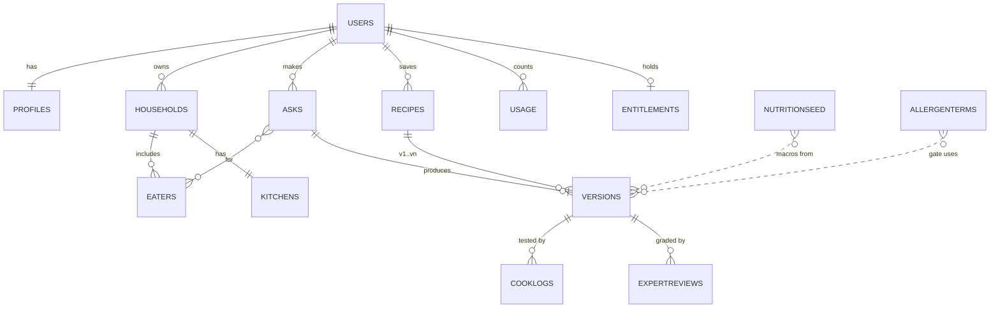

# Recipe Alchemist — Backend schema

**Verdict.** The kitchen run needs ten Convex tables plus the Convex Auth tables; the MVP adds four more.
- **Every row belongs to one user, checked by `ctx.auth` in every function.**
- **Saved versions are immutable**, which is why the test loop can be trusted.
- **The two reference tables are separate from user data**, each with its own truth type, because they become the Gen 1 cooking knowledge base:
  - `nutritionSeed`, which is certain data from USDA
  - `allergenTerms`, a convention reviewed by the expert

## Tables (Convex, `packages/backend/convex/schema.ts`)

### Kitchen run
| Table | Fields | Writes | Reads |
|---|---|---|---|
| `authTables` (Convex Auth) | as provided by `@convex-dev/auth` | auth | auth |
| `profiles` | userId, language ("en"\|"he"), units ("metric"\|"us"), onboardedAt | settings, onboarding | all screens |
| `households` | ownerId, name | onboarding, /household | engine, /household |
| `eaters` | householdId, displayName, ageBand ("child"\|"teen"\|"adult"), allergens[], allergensOther[], diets[], kosher ("none"\|"parve"\|"dairy"\|"meat"), sensory[], sensoryNote, macroTargets? {protein_g, carbs_g, fat_g, kcal, source:"parent-entered"} | /household | engine (prompt + gate), eater picker |
| `kitchens` | householdId, equipment[], cantGet[], region | onboarding, /household | engine |
| `asks` | userId, householdId, eaterIds[], brief, sourceText?, intent, fidelity, language, status ("running"\|"done"\|"refused"\|"error"), model, promptVersion, createdAt | `asks.create`, engine | /ask, /ask/[id] |
| `recipes` | userId, title, createdAt, updatedAt, deletedAt? | `recipes.saveFromAsk` | /cookbook |
| `versions` | recipeId, userId, number, askId, card (RecipeCard JSON), macros {kcal, carbs_g, fibre_g, netCarbs_g?, protein_g, fat_g, source:"USDA FDC", unknownIngredients[]}, gate {passed, checkedAllergens[], eaterIds[], hits[]}, dietWarnings[], createdAt | engine only, insert-only | cookbook detail |
| `cookLogs` | versionId, userId, outcome ("worked"\|"rubbery"\|"dry"\|"spread"\|"off-flavour"), note, cookedAt | /cookbook/[id] | engine (improve), detail |
| `nutritionSeed` | name, aliases[] (English and Hebrew), fdcId, dataType ("Foundation"\|"SR Legacy"), per100g {kcal, carbs_g, fibre_g, sugars_g, protein_g, fat_g}, fetchedAt | seed script only | engine (`macros`) |
| `allergenTerms` | allergen (code), lang ("en"\|"he"), term, reviewedBy?, reviewedAt? | seed script; expert review in the MVP | engine (`allergenGate`) |

### MVP additions
| Table | Fields | Purpose |
|---|---|---|
| `usage` | userId, day (YYYY-MM-DD), asks | free tier of three requests a day |
| `entitlements` | userId, plan ("free"\|"paid"\|"beta"), source ("invite"\|"web"\|"play"), externalId, expiresAt | payments; the vendor writes this through a webhook (vendor UNKNOWN) |
| `invites` | email, invitedBy, acceptedAt? | invite-only beta |
| `expertReviews` | versionId, reviewerId, grade (1–5), safe (bool), note, createdAt | the expert's grading set before each release |

**Allergen codes** use the 14 EU allergen groups as a base: cereals containing gluten, crustaceans, eggs, fish, peanuts, soybeans, milk, tree nuts, celery, mustard, sesame, sulphites, lupin and molluscs. *(EXTRAPOLATED; the expert confirms the Israeli list)*

## Indexes
- `eaters.by_household`
- `asks.by_user_createdAt`
- `recipes.by_user_updatedAt`
- `versions.by_recipe_number`
- `cookLogs.by_version`
- `nutritionSeed.by_name`, plus a search index on `aliases`
- `allergenTerms.by_allergen_lang`
- `usage.by_user_day`

## Functions
| Function | Type | What it does |
|---|---|---|
| `asks.create` | mutation | checks auth (and usage in the MVP), inserts an ask with status "running", schedules `engine.run` |
| `engine.run` | action | loads the eaters and kitchen → `core.buildPrompt` → `providerSeam` → `core.parseCard` → `core.allergenGate` (regenerates once on a hit) → `core.dietChecks` → `core.macros` → patches the ask to "done", "refused" or "error" |
| `recipes.saveFromAsk` | mutation | creates the recipe plus version 1 from a finished ask |
| `versions.improveFromLog` | action | version + log + eaters → engine → inserts version n+1 with `card.changedBecause` |
| `versions.convertAgain` | mutation | prefills a new ask linked to the recipe; the result becomes version n+1 |
| `cookLogs.add` | mutation | checks the version is owned by the user, inserts the log |
| `household.*` | mutations and queries | CRUD for eaters and the kitchen; owner only |
| `account.delete` | action | deletes every row by userId, then the auth user *(EXTRAPOLATED: immediate delete)* |
| `seed.nutrition` | internal action | run by `scripts/build-nutrition-seed.ts`; needs `FDC_API_KEY` |
| `seed.allergens` | internal mutation | loads the English and Hebrew synonym list from `packages/core/data/allergen-terms.json` |

## Who can see what
- A user sees only rows where `userId` (or the household's `ownerId`) matches their own id. No household sharing in the MVP. *(EXTRAPOLATED)*
- `nutritionSeed` and `allergenTerms` are readable by the engine only, and written only by internal functions.
- Versions can't be edited or deleted. Deleting a recipe sets `deletedAt` on the recipe, which hides its versions; account deletion removes them all.
- No model output is stored except inside `versions.card` and `asks`.

## Sign-in flow
1. The user enters their email, and the client calls `signIn("resend", formData)` (Convex Auth).
2. Resend sends the magic link. Env vars: `AUTH_RESEND_KEY`, `SITE_URL`.
3. The link opens the app and Convex Auth creates a session. A first sign-in goes to `/onboarding`; after that it goes to `/ask`.
4. MVP only: if the email isn't in `invites` and the user has no entitlement, show the "join the waitlist" screen.

## ER diagram

## Gen 1 path
The four July knowledge layers become separate tables, each with its own truth type, never merged:
- `chemistry`: certain; from USDA plus food-science texts
- `failures`: probabilistic; from cook logs and expert reviews
- `availability`: changes often; Israeli shelves and kosher status
- `techniques`: a convention; skills drawn from canonical texts

Together they make up the cooking "Context7" connector. `nutritionSeed`, `allergenTerms` and `cookLogs` are its first seed.

## Open questions for Amit
1. Should allergens be based on the EU list of 14 plus free text, or on a specific Israeli list? The expert to confirm.
2. Should account deletion be immediate, or have a 30-day grace period?
3. Should a household be shareable with a partner or co-parent in the MVP?
4. Do you want to see anonymised cook logs to improve the engine? That needs consent wording.

## Sources
- Convex Auth: https://labs.convex.dev/auth/config/email
- USDA FoodData Central: https://fdc.nal.usda.gov/api-guide
- EU 1169/2011, allergens in Annex II: https://eur-lex.europa.eu/legal-content/EN/TXT/HTML/?uri=CELEX:02011R1169-20180101
- Internal: the September Brief 3 data list; the July "four data layers" chat (Basic Memory, "Code translation across programming languages", 3 July 2026)
